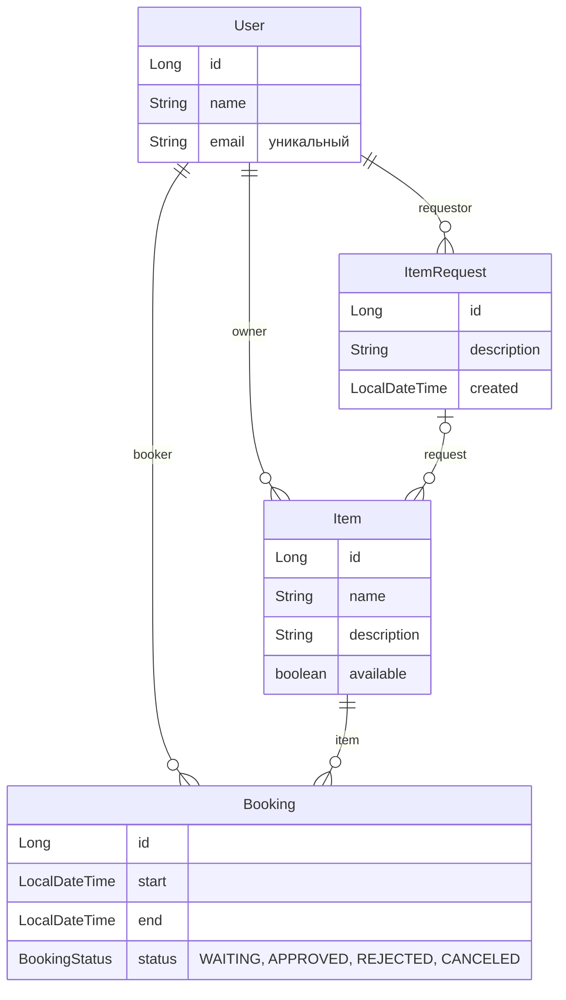

# java-shareit

Учебный backend-проект на Java и Spring Boot: сервис для шеринга вещей. Пользователи выкладывают
вещи, которые готовы дать на время, и находят нужные через поиск. Пока данные хранятся в памяти;
бронирование, запросы вещей и база данных появятся на следующих этапах.

## Автор
**Ксения Пылькина** *(Ksenia Pylkina)*

## Реализация по этапам

Каждый этап — отдельный спринт курса: своя ветка и pull request в `main`.

<details open>
<summary><strong>Этап 1 — Пользователи и вещи: REST API с хранением в памяти</strong></summary>

На этом этапе шаблон с заглушками превратился в рабочий сервис: пользователи, вещи и поиск,
валидация, обработка ошибок и хранилища в памяти. Ветка `add-controllers`.

**Что сделано:**
- Модели `User`, `Item`, `Booking`, `ItemRequest` и enum `BookingStatus` собраны в пакетах
  `model`; связи между сущностями — объектами (`owner`, `request`, `item`, `booker`).
- DTO `UserDto` и `ItemDto` с мапперами `UserMapper` и `ItemMapper`: API не зависит от моделей.
- Хранилища `UserRepository` и `ItemRepository` с in-memory реализациями.
- Сервисы `UserService` и `ItemService`: уникальность email, права владельца, поиск.
- Контроллеры `UserController` и `ItemController` с логированием запросов.
- Валидация через `jakarta.validation` с группами `OnCreate` и `OnUpdate`.
- Исключения `NotFoundException`, `ForbiddenException`, `ConflictException`
  и общий обработчик `ErrorHandler`.
- Статусы по REST: создание — 201, удаление — 204.

**Ключевые решения:**
- Один DTO и на создание, и на обновление, как требует ТЗ. Разницу в правилах закрывают группы
  валидации и своя аннотация `@NullOrNotBlank`: поле можно не присылать, но пустым оно быть
  не может.
- Обработчик ошибок ловит `RuntimeException`, а не `Exception`, поэтому встроенные ответы Spring
  404 и 405 не превращаются в 500.
- Вещи проиндексированы по владельцу, и `GET /items` не перебирает весь каталог. Индекс
  не устаревает: владелец у вещи не меняется.
- Уникальность email проверяется перебором, без индекса: email меняется при обновлении,
  а в базе данных это станет уникальным ограничением.
- Чужой пользователь при попытке изменить вещь получает 403, а не 404: вещь существует
  и видна всем через `GET`.
- Методы хранилищ названы как в Spring Data (`save`, `findById`, `findAllByOwnerId`,
  `existsByEmail`), чтобы переход на JPA почти не затронул сервисы.

**Результат:**
- API пользователей и вещей проходит Postman-тесты спринта в CI.
- Код проходит проверки checkstyle и SpotBugs.
- Хранилища спрятаны за интерфейсами: на следующем этапе их заменит база данных,
  а контроллеры останутся прежними.

</details>

## Ключевые возможности

- CRUD-операции для пользователей; email уникален без учёта регистра; вместе с пользователем
  удаляются его вещи.
- Добавление, редактирование и просмотр вещей; изменить вещь может только её владелец.
- Частичное обновление через `PATCH`: неприсланное поле остаётся прежним, пустое — ошибка 400.
- Поиск доступных вещей по подстроке в названии или описании без учёта регистра.
- Пользователь, от имени которого идёт запрос, передаётся в заголовке `X-Sharer-User-Id`.
- Централизованная обработка ошибок (`@RestControllerAdvice`) с единым телом `{"error": "..."}`:
  ошибки клиента — 400, 403, 404 и 409, непредвиденные — 500 с общим сообщением,
  подробности только в логе.
- Слоистая архитектура: контроллер → сервис → хранилище; DTO и мапперы отделяют API от моделей.
- Внедрение зависимостей через конструктор (`@RequiredArgsConstructor`).

## Технологии

- **Java 21**
- **Spring Boot 3.3.2**
    - `spring-boot-starter-web` (REST API)
    - `spring-boot-starter-validation` (валидация данных)
- **Lombok** (генерация boilerplate-кода и логгеров)
- **Maven** (сборка проекта)
- **Checkstyle** и **SpotBugs** (контроль стиля и статический анализ)
- **Postman** и **GitHub Actions** (автотесты API на каждый pull request)

## Архитектура проекта

```
ru.practicum.shareit
├── ShareItApp.java    точка входа
├── common/            имя заголовка X-Sharer-User-Id
├── exception/         исключения и глобальный обработчик ошибок
├── validation/        группы валидации и @NullOrNotBlank
├── user/              пользователи: контроллер, dto, mapper, model, repository, service
├── item/              вещи: контроллер, dto, mapper, model, repository, service
├── booking/           бронирование: модель готова, API — на следующем этапе
└── request/           запросы вещей: модель готова, API — на третьем этапе
```

Все фичи устроены одинаково: контроллер в корне пакета, рядом `dto`, `mapper`, `model`,
`repository` и `service`. Сервисы зависят от интерфейсов хранилищ, а не от реализаций.

## Запуск проекта

1. Склонировать репозиторий.
2. Открыть проект в **IntelliJ IDEA** с **JDK 21**.
3. Дождаться загрузки зависимостей Maven.
4. Запустить метод `main` в классе `ShareItApp`.

После запуска сервер будет доступен на порту **8080**. Данные хранятся в памяти и пропадают
при перезапуске.

Проверка, как в CI: `mvn verify -P check` (checkstyle, тесты и SpotBugs). Для проверки
запросов можно использовать **Postman** (коллекция `postman/sprint.json` доступна
в шаблоне курса).

## Основные HTTP-эндпоинты

Запросы от имени пользователя передают его id в заголовке `X-Sharer-User-Id`.

### Пользователи (`/users`)
- `POST /users` — создать пользователя.
- `PATCH /users/{userId}` — изменить имя и/или email.
- `GET /users/{userId}` — получить пользователя по ID.
- `GET /users` — получить список всех пользователей.
- `DELETE /users/{userId}` — удалить пользователя.

### Вещи (`/items`)
- `POST /items` — добавить вещь; владелец — пользователь из заголовка.
- `PATCH /items/{itemId}` — изменить название, описание или доступность; только для владельца.
- `GET /items/{itemId}` — получить вещь по ID; заголовок не нужен.
- `GET /items` — получить все вещи пользователя из заголовка.
- `GET /items/search?text={text}` — найти доступные вещи по названию или описанию;
  пустой `text` — пустой список.

### Коды ответа
- `200` — данные получены или обновлены
- `201` — объект создан
- `204` — пользователь удалён
- `400` — некорректный запрос: ошибка валидации, нет заголовка или параметра, битый JSON
- `403` — вещь пытается изменить не владелец
- `404` — пользователь или вещь не найдены
- `409` — email уже занят
- `500` — непредвиденная ошибка сервера

Тело ошибки всегда в формате `{"error": "..."}`.

## Модель данных



| Сущность | Что хранит |
|---|---|
| `User` | пользователь: имя и email |
| `Item` | вещь: название, описание, доступность, владелец и запрос, если вещь добавили в ответ на него |
| `ItemRequest` | просьба найти вещь, которой пока нет в сервисе |
| `Booking` | бронь вещи на даты; действует после подтверждения владельцем |

Связи хранятся объектами, а не id: у вещи — владелец и запрос, у брони — вещь и арендатор.
Сейчас API есть у пользователей и вещей; бронирование и запросы подключатся на следующих этапах.

## Ограничения учебной реализации

- Данные хранятся **только в памяти**: после перезапуска всё теряется.
- Хранилища **не потокобезопасны**: `HashMap` и счётчик `long` без синхронизации.
- **Нет аутентификации**: id пользователя приходит в заголовке, и сервис ему доверяет.
- Бронирование и запросы вещей пока есть только в модели данных.