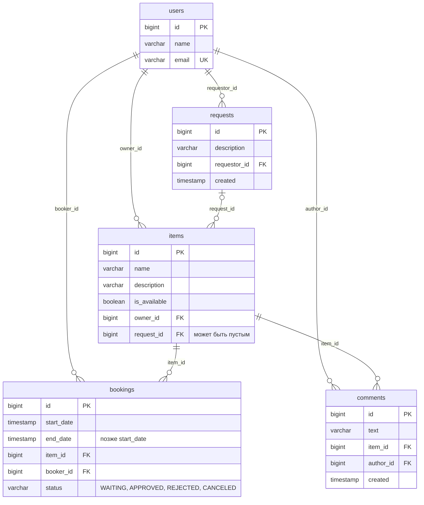

# java-shareit

Учебный backend-проект на Java и Spring Boot: сервис для шеринга вещей. Пользователи выкладывают
вещи, которые готовы дать на время, находят нужные через поиск, бронируют их на даты и оставляют
отзывы. Данные хранятся в PostgreSQL; запросы вещей появятся на следующих этапах.

## Автор
**Ксения Пылькина** *(Ksenia Pylkina)*

## Реализация по этапам

Каждый этап — отдельный спринт курса: своя ветка и pull request в `main`.

<details>
<summary><strong>Этап 1 — Пользователи и вещи: REST API с хранением в памяти</strong></summary>

На этом этапе шаблон с заглушками превратился в рабочий сервис: пользователи, вещи и поиск,
валидация, обработка ошибок и хранилища в памяти. Ветка `add-controllers`.

**Что сделано:**
- Модели `User`, `Item`, `Booking`, `ItemRequest` и enum `BookingStatus` собраны в пакетах
  `model`; связи между сущностями — объектами (`owner`, `request`, `item`, `booker`).
- DTO `UserDto` и `ItemDto` с мапперами `UserMapper` и `ItemMapper`: API не зависит от моделей.
- Хранилища `UserRepository` и `ItemRepository` с in-memory реализациями.
- Сервисы `UserService` и `ItemService`: уникальность email, права владельца, поиск.
- Контроллеры `UserController` и `ItemController` с логированием запросов.
- Валидация через `jakarta.validation` с группами `OnCreate` и `OnUpdate`.
- Исключения `NotFoundException`, `ForbiddenException`, `ConflictException`
  и общий обработчик `ErrorHandler`.
- Статусы по REST: создание — 201, удаление — 204.

**Ключевые решения:**
- Один DTO и на создание, и на обновление, как требует ТЗ. Разницу в правилах закрывают группы
  валидации и своя аннотация `@NullOrNotBlank`: поле можно не присылать, но пустым оно быть
  не может.
- Обработчик ошибок ловит `RuntimeException`, а не `Exception`, поэтому встроенные ответы Spring
  404 и 405 не превращаются в 500.
- Вещи проиндексированы по владельцу, и `GET /items` не перебирает весь каталог. Индекс
  не устаревает: владелец у вещи не меняется.
- Уникальность email проверяется перебором, без индекса: email меняется при обновлении,
  а в базе данных это станет уникальным ограничением.
- Чужой пользователь при попытке изменить вещь получает 403, а не 404: вещь существует
  и видна всем через `GET`.
- Методы хранилищ названы как в Spring Data (`save`, `findById`, `findAllByOwnerId`,
  `existsByEmail`), чтобы переход на JPA почти не затронул сервисы.

**Результат:**
- API пользователей и вещей проходит Postman-тесты спринта в CI.
- Код проходит проверки checkstyle и SpotBugs.
- Хранилища спрятаны за интерфейсами: на следующем этапе их заменит база данных,
  а контроллеры останутся прежними.

</details>

<details open>
<summary><strong>Этап 2 — Бронирование и отзывы: хранение в PostgreSQL через JPA</strong></summary>

На этом этапе данные переехали из памяти в PostgreSQL, а сервис научился бронировать вещи
и принимать отзывы. Ветка `add-bookings`.

**Что сделано:**
- Схема базы `schema.sql`: таблицы `users`, `requests`, `items`, `bookings` и `comments`
  с внешними ключами, именованными ограничениями и индексами.
- Модели `User`, `Item`, `ItemRequest`, `Booking` и новая `Comment` стали сущностями JPA.
- Хранилища в памяти заменены интерфейсами Spring Data JPA: методы-запросы по имени
  и запрос на JPQL для поиска.
- Бронирование: создание брони, подтверждение или отклонение владельцем, просмотр брони
  и списков броней арендатора и владельца с фильтром по состоянию.
- Владелец видит у своих вещей последнюю и ближайшую брони.
- Отзывы к вещам: оставить отзыв можно только после завершённой аренды, отзывы видны
  в карточке вещи.
- DTO `NewBookingDto`, `BookingDto`, `BookingShortDto`, `ItemWithBookingsDto`, `CommentDto`
  и мапперы `BookingMapper`, `CommentMapper`.
- Транзакции в сервисах: `@Transactional(readOnly = true)` на классе, `@Transactional`
  на методах, которые меняют данные.
- Тесты работают на H2 в памяти, приложение — на PostgreSQL.

**Ключевые решения:**
- Таблицы создаёт `schema.sql`, а Hibernate с `ddl-auto=validate` только сверяет с ними
  сущности: ошибка в маппинге не даст приложению запуститься.
- Удаление пользователя доверено базе: `ON DELETE CASCADE` удаляет его вещи, брони
  и отзывы.
- Все связи `@ManyToOne` ленивые. Вещь и арендатор для ответов о бронях приходят тем же
  запросом через `@EntityGraph`, брони и отзывы для списка вещей — одним запросом на все
  вещи сразу. Так нет проблемы N + 1.
- Последняя и ближайшая брони считаются только по подтверждённым и показываются только
  владельцу вещи.
- Посторонний пользователь при просмотре или подтверждении чужой брони получает 403.
  Бронь своей вещи и повторное решение по брони — 400.
- Даты брони сравниваются с текущим временем с точностью до секунды: бронь, которая
  начинается в эту секунду, не считается прошлой.
- Нарушение ограничения базы, например два одновременных запроса с одним email, возвращает 409;
  текст ошибки СУБД остаётся в логе.

**Результат:**
- API пользователей, вещей, бронирования и отзывов проходит Postman-тесты спринта в CI.
- Код проходит проверки checkstyle и SpotBugs.
- Данные не пропадают при перезапуске приложения.

</details>

## Ключевые возможности

- CRUD-операции для пользователей; email уникален без учёта регистра; вместе с пользователем
  удаляются его вещи, брони и отзывы.
- Добавление, редактирование и просмотр вещей; изменить вещь может только её владелец.
- Частичное обновление через `PATCH`: неприсланное поле остаётся прежним, пустое — ошибка 400.
- Поиск доступных вещей по подстроке в названии или описании без учёта регистра.
- Бронирование вещи на даты: новая бронь ждёт решения владельца (`WAITING`), владелец
  подтверждает её (`APPROVED`) или отклоняет (`REJECTED`).
- Списки броней арендатора и владельца от новых к старым с фильтром по состоянию: все,
  текущие, завершённые, будущие, ожидающие подтверждения, отклонённые.
- Владелец видит у своих вещей последнюю и ближайшую подтверждённые брони.
- Отзывы после завершённой аренды; в карточке вещи — все отзывы с именем автора и датой.
- Пользователь, от имени которого идёт запрос, передаётся в заголовке `X-Sharer-User-Id`.
- Централизованная обработка ошибок (`@RestControllerAdvice`) с единым телом `{"error": "..."}`:
  ошибки клиента — 400, 403, 404 и 409, непредвиденные — 500 с общим сообщением,
  подробности только в логе.
- Хранение в PostgreSQL через Spring Data JPA; схема базы — в `schema.sql`.
- Слоистая архитектура: контроллер → сервис → репозиторий; DTO и мапперы отделяют API от моделей.
- Внедрение зависимостей через конструктор (`@RequiredArgsConstructor`).

## Технологии

- **Java 21**
- **Spring Boot 3.3.2**
    - `spring-boot-starter-web` (REST API)
    - `spring-boot-starter-validation` (валидация данных)
    - `spring-boot-starter-data-jpa` (Spring Data JPA и Hibernate)
- **PostgreSQL** (база данных приложения)
- **H2** (база в памяти для тестов)
- **Lombok** (генерация boilerplate-кода и логгеров)
- **Maven** (сборка проекта)
- **Checkstyle** и **SpotBugs** (контроль стиля и статический анализ)
- **Postman** и **GitHub Actions** (автотесты API на каждый pull request)

## Архитектура проекта

```
ru.practicum.shareit
├── ShareItApp.java    точка входа
├── common/            имя заголовка X-Sharer-User-Id
├── exception/         исключения и глобальный обработчик ошибок
├── validation/        группы валидации, @NullOrNotBlank и сравнение дат до секунды
├── user/              пользователи: контроллер, dto, mapper, model, repository, service
├── item/              вещи и отзывы: контроллер, dto, mapper, model, repository, service
├── booking/           бронирование: контроллер, dto, mapper, model, repository, service
└── request/           запросы вещей: сущность и таблица готовы, API — на следующих этапах

resources
├── application.properties         подключение к PostgreSQL, ddl-auto=validate, логи SQL
├── application-test.properties    H2 в памяти для тестов
└── schema.sql                     схема базы: таблицы, ключи, ограничения, индексы
```

Все фичи устроены одинаково: контроллер в корне пакета, рядом `dto`, `mapper`, `model`,
`repository` и `service`. Репозитории — интерфейсы Spring Data JPA: реализации для них
Spring создаёт сам.

## Запуск проекта

1. Склонировать репозиторий.
2. Установить **PostgreSQL** и создать пользователя и базу `shareit`, например в SQL Shell (psql)
   от имени `postgres`:
   ```sql
   CREATE ROLE shareit WITH LOGIN PASSWORD 'shareit';
   CREATE DATABASE shareit OWNER shareit;
   ```
3. Открыть проект в **IntelliJ IDEA** с **JDK 21**.
4. Дождаться загрузки зависимостей Maven.
5. Запустить метод `main` в классе `ShareItApp`.

После запуска сервер будет доступен на порту **8080**. Таблицы приложение создаёт само
из `schema.sql`, если их ещё нет. Адрес базы, логин и пароль заданы в `application.properties`,
их можно переопределить переменными окружения `SPRING_DATASOURCE_URL`,
`SPRING_DATASOURCE_USERNAME` и `SPRING_DATASOURCE_PASSWORD` — так приложение запускается в CI.

Проверка, как в CI: `mvn verify -P check` (checkstyle, тесты и SpotBugs). Тесты работают
на H2 в памяти, PostgreSQL для них не нужен. Для проверки запросов можно использовать
**Postman** (коллекция `postman/sprint.json` доступна в шаблоне курса).

## Основные HTTP-эндпоинты

Запросы от имени пользователя передают его id в заголовке `X-Sharer-User-Id`.

### Пользователи (`/users`)
- `POST /users` — создать пользователя.
- `PATCH /users/{userId}` — изменить имя и/или email.
- `GET /users/{userId}` — получить пользователя по ID.
- `GET /users` — получить список всех пользователей.
- `DELETE /users/{userId}` — удалить пользователя вместе с его вещами, бронями и отзывами.

### Вещи (`/items`)
- `POST /items` — добавить вещь; владелец — пользователь из заголовка.
- `PATCH /items/{itemId}` — изменить название, описание или доступность; только для владельца.
- `GET /items/{itemId}` — получить вещь по ID с отзывами; владелец видит ещё последнюю
  и ближайшую брони. Заголовок необязателен.
- `GET /items` — получить все вещи пользователя из заголовка с бронями и отзывами.
- `GET /items/search?text={text}` — найти доступные вещи по названию или описанию;
  пустой `text` — пустой список.
- `POST /items/{itemId}/comment` — оставить отзыв о вещи; только после завершённой
  подтверждённой брони.

### Бронирование (`/bookings`)
- `POST /bookings` — забронировать вещь на даты; бронь создаётся в статусе `WAITING`.
- `PATCH /bookings/{bookingId}?approved={true|false}` — подтвердить или отклонить бронь;
  только для владельца вещи.
- `GET /bookings/{bookingId}` — получить бронь; только арендатору или владельцу вещи.
- `GET /bookings?state={state}` — брони пользователя из заголовка.
- `GET /bookings/owner?state={state}` — брони вещей пользователя из заголовка.

`state` — необязательный параметр, по умолчанию `ALL`: `ALL`, `CURRENT`, `PAST`, `FUTURE`,
`WAITING`, `REJECTED`. Списки отсортированы по дате начала, от новых к старым.

### Коды ответа
- `200` — данные получены или обновлены
- `201` — объект создан
- `204` — пользователь удалён
- `400` — некорректный запрос: ошибка валидации, нет заголовка или параметра, битый JSON,
  неизвестный `state`; бронь недоступной или своей вещи, повторное решение по брони,
  отзыв без завершённой брони
- `403` — вещь пытается изменить не владелец; чужую бронь смотрит или подтверждает
  посторонний
- `404` — пользователь, вещь или бронь не найдены
- `409` — email уже занят или запись нарушает ограничение базы
- `500` — непредвиденная ошибка сервера

Тело ошибки всегда в формате `{"error": "..."}`.

## Модель данных



| Таблица | Сущность | Что хранит |
|---|---|---|
| `users` | `User` | пользователь: имя и email |
| `requests` | `ItemRequest` | просьба найти вещь, которой пока нет в сервисе |
| `items` | `Item` | вещь: название, описание, доступность, владелец и запрос, если вещь добавили в ответ на него |
| `bookings` | `Booking` | бронь вещи на даты; действует после подтверждения владельцем |
| `comments` | `Comment` | отзыв о вещи от того, кто её брал |

Внешние ключи удаляют зависимые записи каскадом: вместе с пользователем база удаляет его
запросы, вещи, брони и отзывы, а заодно брони и отзывы на его вещи. Удаление запроса вещь
переживает — `request_id` становится пустым. В Java связи хранятся объектами с ленивой
загрузкой: у вещи — владелец и запрос, у брони — вещь и арендатор, у отзыва — вещь и автор.

## Ограничения учебной реализации

- **Нет аутентификации**: id пользователя приходит в заголовке, и сервис ему доверяет.
- **Нет пагинации**: списки вещей и броней приходят целиком.
- **Пересечение броней не проверяется**: на одни и те же даты вещь можно забронировать
  дважды, решение остаётся за владельцем.
- Статус `CANCELED` есть в модели, но отменить бронь через API пока нельзя.
- Время — по часам сервера, без часовых поясов (`LocalDateTime`).
- Запросы вещей пока есть только в базе и модели данных.